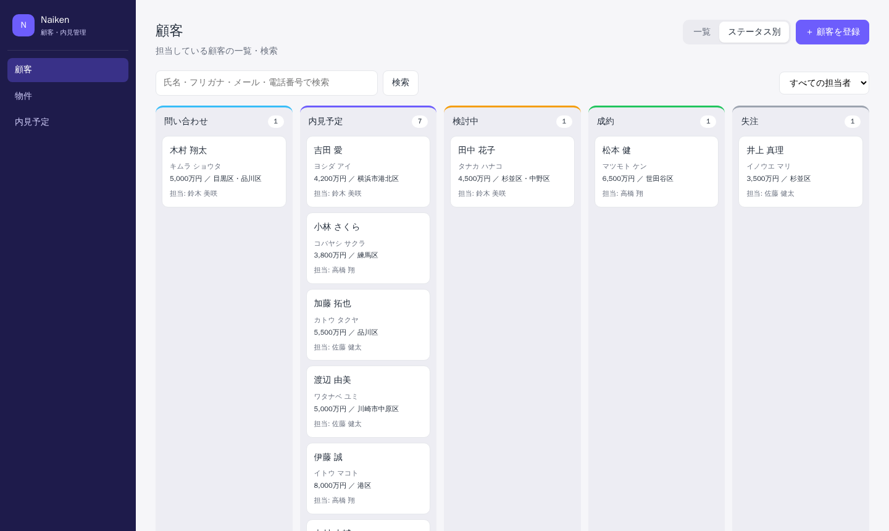
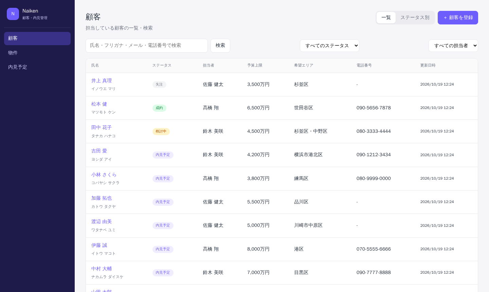
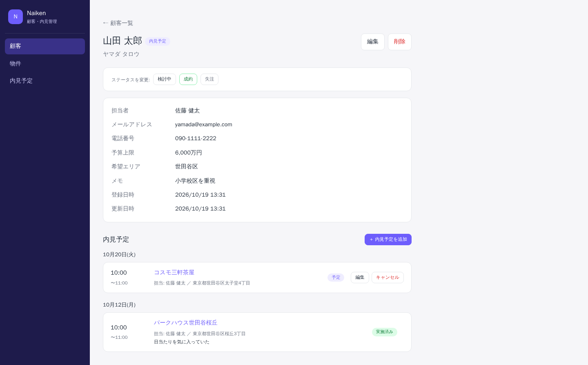
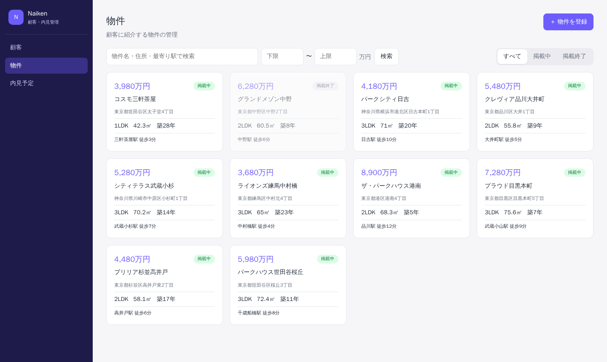
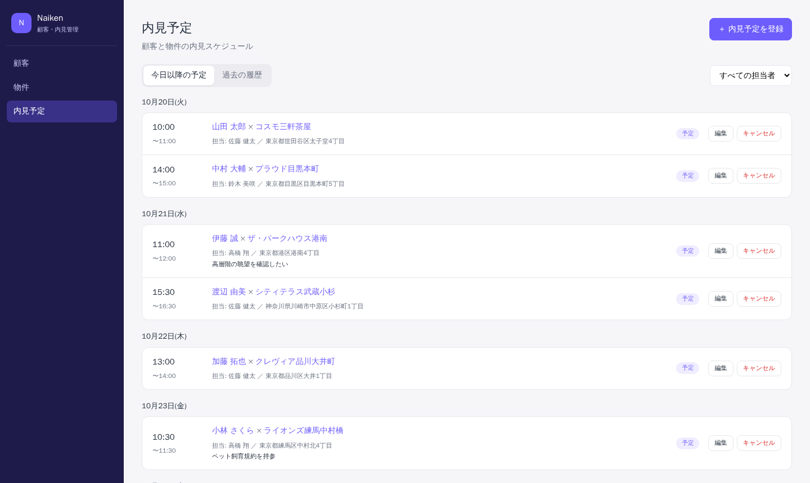
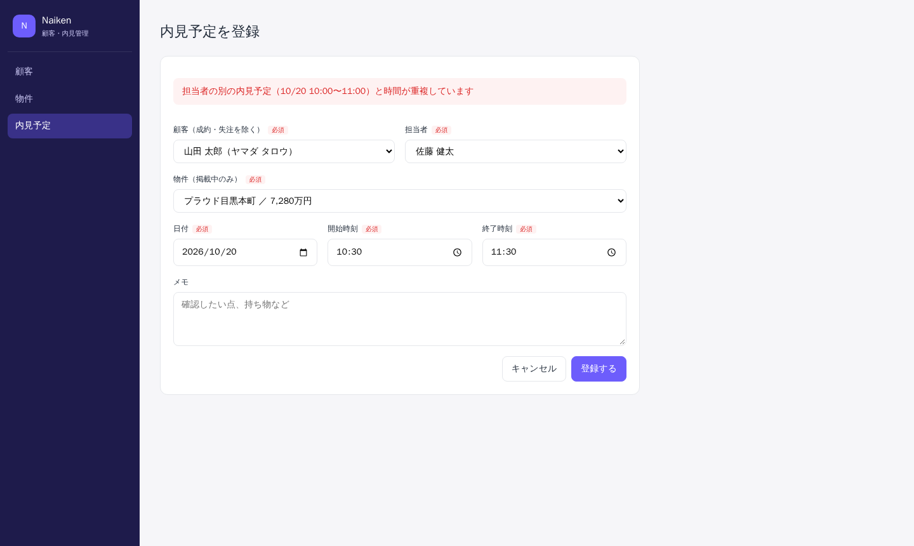

# Naiken — 不動産仲介向け 顧客・内見管理システム

[](https://github.com/keisuke-nagaoka/Ruby-on-Rails_App/actions/workflows/ci.yml)

不動産仲介の営業担当者が、**顧客・物件・内見予定・対応状況**を一元管理する Web アプリケーションです。
Ruby on Rails（API）と React（TypeScript）で構成し、Docker 上で開発、AWS（EC2 / RDS）で公開する前提で構築しています。

- 公開URL: https://rails.keisuke-nagaoka.com/naiken/ （準備中）



## 目次

- [このアプリについて](#このアプリについて)
- [画面](#画面)
- [主な機能](#主な機能)
- [業務ルール](#業務ルール)
- [技術構成](#技術構成)
- [設計で意識したこと](#設計で意識したこと)
- [Laravel と Rails の違い](#laravel-と-rails-の違い)
- [実装中に調べたこと・解決したこと](#実装中に調べたこと解決したこと)
- [テスト・CI](#テストci)
- [ローカルで動かす](#ローカルで動かす)
- [今後の予定](#今後の予定)

## このアプリについて

これまで PHP / Laravel で業務システムを開発してきました。その経験が Ruby on Rails でも活かせることを、実際に動くもので示すために作ったポートフォリオです。

単に登録・一覧・編集・削除（CRUD）を作るのではなく、**不動産仲介の業務ルールをプログラムに落とし込むこと**を重視しました。
「同じ担当者に時間の重なる内見予定を入れられない」「成約した顧客には内見予定を追加できない」といったルールをモデルに実装し、テストで保証しています。

また、Laravel との違いや、実装中に詰まったこと・調べたことを [Laravel と Rails の違い](#laravel-と-rails-の違い) と [実装中に調べたこと・解決したこと](#実装中に調べたこと解決したこと) に記録しています。

## 画面

| 顧客一覧（検索・ステータス・担当者で絞り込み） | 顧客詳細（ステータス変更・内見予定） |
| --- | --- |
|  |  |
| **物件一覧（掲載状況・価格帯で絞り込み）** | **内見予定（日付ごとの一覧）** |
|  |  |

業務ルールに違反する操作は、サーバー側で検証してメッセージを返します（例: 担当者の予定の重複）。



## 主な機能

| 機能 | 内容 |
| --- | --- |
| 顧客管理 | 登録・編集・削除、氏名・フリガナ・メール・電話番号での検索、担当者・ステータスでの絞り込み、ページネーション |
| 物件管理 | 登録・編集・削除、物件名・住所・最寄り駅での検索、掲載状況・価格帯での絞り込み |
| 内見予定 | 顧客と物件を紐づけた予定の登録・変更、実施済み・キャンセルの操作、日付ごとの一覧、顧客・物件ごとの履歴表示 |
| 対応ステータス | 問い合わせ → 内見予定 → 検討中 → 成約 / 失注 の管理、ステータス別のボード表示 |
| 入力の検証 | 項目ごとの日本語エラーメッセージ、全角数字・前後の空白などの表記ゆれの正規化 |

## 業務ルール

### 対応ステータスの遷移

```
問い合わせ ─→ 内見予定 ⇄ 検討中 ─→ 成約（以降は変更不可）
   │            │         │
   └────────────┴─────────┴──→ 失注 ─→ 問い合わせ（再開）
```

### ルール一覧

| ルール | 実装 |
| --- | --- |
| 同じ担当者に、時間帯が重複する内見予定は登録できない（同時リクエストでも二重登録されない） | [`Viewing`](apps/naiken/backend/app/models/viewing.rb) |
| 掲載終了の物件には内見予定を登録できない | [`Viewing`](apps/naiken/backend/app/models/viewing.rb) |
| 実施済み・キャンセル済みの内見予定は変更できない／開始時刻前の予定は実施済みにできない | [`Viewing`](apps/naiken/backend/app/models/viewing.rb) |
| 対応ステータスは上の図の順序でしか変更できない（問い合わせから直接成約にはできない、成約後は変更できない） | [`Customer`](apps/naiken/backend/app/models/customer.rb) |
| 成約・失注の顧客には内見予定を登録できない | [`Viewing`](apps/naiken/backend/app/models/viewing.rb) |
| 成約・失注になったら、予定中の内見予定を自動でキャンセルする | [`Customer`](apps/naiken/backend/app/models/customer.rb) |
| 内見予定を登録すると「内見予定」に、予定中の内見がすべて実施済みになると「検討中」に自動で進む | [`Customer`](apps/naiken/backend/app/models/customer.rb) / [`Viewing`](apps/naiken/backend/app/models/viewing.rb) |
| 成約済みの顧客、内見予定のある顧客・物件・担当者は削除できない（履歴の保護） | [`Customer`](apps/naiken/backend/app/models/customer.rb) / 各モデルの `restrict_with_error` |

## 技術構成

| 領域 | 技術 |
| --- | --- |
| バックエンド | Ruby 3.4 / Ruby on Rails 8.1（API mode） |
| フロントエンド | React 19 / TypeScript / Vite / React Router |
| DB | MySQL 8.0（本番: Amazon RDS for MySQL） |
| テスト・静的解析 | RSpec / FactoryBot / RuboCop / Brakeman / bundler-audit（バックエンド）、Vitest / Testing Library / oxlint（フロントエンド） |
| CI | GitHub Actions |
| インフラ | Docker / nginx / AWS（EC2・RDS・Route 53） |

```
Browser ──HTTPS──> nginx
                    ├─ /naiken/      → React（本番はビルド成果物を静的配信、ローカルは Vite）
                    └─ /naiken/api/  → Rails API（Puma） ──> MySQL（本番は RDS に TLS で接続）
```

画面と API を同じドメインの別パスで配信しているため、CORS の設定は不要です。
ローカルと本番の違いは [docs/infrastructure.md](docs/infrastructure.md) にまとめています。

## 設計で意識したこと

### API

- `/api/v1` でバージョニングし、レスポンスは `{ data, meta }`、エラーは `{ error: { code, message, details } }` に統一した。フロントエンドは `details` を使って項目ごとにエラーを表示する（[API リファレンス](docs/api.md)）
- JSON の組み立ては `app/serializers` のクラスに分け、モデルの全カラムをそのまま返さないようにした
- 想定外のエラー（500）では例外メッセージやスタックトレースを返さず、ログと突き合わせるための `request_id` だけを返す。存在しない URL も HTML ではなく JSON の 404 を返し、フロントエンドが常に同じ形式でエラーを扱えるようにした

### 業務ルール

- 内見予定のステータスは通常の更新 API では変更できないようにし、`complete` / `cancel` という専用のエンドポイントでのみ変更させた。顧客の対応ステータスも同様に `PATCH /customers/:id/status` でのみ変更する
- 顧客の対応ステータスの遷移ルールは `STATUS_TRANSITIONS` という表（Hash）で定義し、ルールの全体像が1か所で読めるようにした。テストもこの表を元に「許可される遷移」「許可されない遷移」を全パターン生成している
- API は顧客ごとに「次に変更できるステータス（`next_statuses`）」を返し、画面はそれをボタンとして表示するだけにした。遷移ルールをフロントエンドに重複して持たないため、ルールを変えてもサーバー側の修正だけで済む
- 業務ルール違反（予定の重複など）は特定の項目ではなく `base` のエラーとして返し、画面上部にメッセージを表示する

### データの整合性

- 担当者の予定の重複チェックは「チェックしてから保存する」までの間に別のリクエストが割り込むと二重登録になる。そこで保存前に担当者の行を `SELECT ... FOR UPDATE` でロックし、同じ担当者への登録を直列化した（別の担当者への登録は並行して処理できる）
- 成約・失注時の「内見予定の一括キャンセル」は、ステータス変更と同じトランザクションで行い、どちらか一方だけが反映されることがないようにした
- 価格は「万円」単位の整数で保存し、小数の誤差が出ないようにした。専有面積は `decimal` で保存し、JSON では文字列にならないよう数値に変換して返す
- ステータスは文字列の `enum` で保存し、DB を直接見ても値の意味が分かるようにした。`validate: true` を指定し、未定義の値が送られても例外ではなくバリデーションエラー（422）になるようにした

### 性能・安全性

- 一覧取得では `includes` で関連データをまとめて読み込み、N+1 問題を防いでいる
- 検索の `LIKE` では `sanitize_sql_like` で `%` `_` をエスケープし、ユーザー入力がワイルドカードとして解釈されないようにした
- 入力値の表記ゆれ（全角の電話番号、前後の空白、空文字）は `normalizes` で保存前に正規化した
- 本番では Host ヘッダーの許可リスト、RDS との TLS 接続（証明書検証あり）を設定した

### フロントエンド

- 一覧の検索条件は URL のクエリに持たせ、リロードやブラウザバックでも条件が保持されるようにした
- 内見の日時は日本時間のオフセット付き（`+09:00`）で送信し、ブラウザのタイムゾーンに左右されないようにした
- 入力欄とエラー表示（`Field`）、内見予定の一覧（`ViewingList`）などを共通コンポーネントにし、顧客・物件・内見予定の画面で使い回している

## Laravel と Rails の違い

実装しながら気づいた違いを、Laravel での書き方と対比して記録しています。

| 観点 | Laravel | Rails |
| --- | --- | --- |
| ORM | Eloquent | Active Record |
| マイグレーション | `up()` / `down()` を書くことが多い | `change` だけで、ロールバック時の処理を自動で推測してくれる |
| バリデーション | FormRequest（コントローラーの手前で検証） | モデルの `validates`（保存時に検証） |
| 許可する入力項目 | `$fillable` / `$request->validated()` | Strong Parameters（`params.expect`） |
| 値の整形 | Mutator / `Attribute::make(set:)` | `normalizes` |
| 検索条件の再利用 | ローカルスコープ（`scopeXxx`） | `scope` |
| APIリソース | API Resource（`JsonResource`） | 今回はシリアライザークラスを自作 |
| ルーティング | `Route::apiResource` | `resources ... only:` |
| RESTに当てはまらない操作 | `Route::patch('viewings/{id}/complete')` | `member do patch :complete end` |
| 列挙型 | PHP の `enum` + `$casts` | `enum :status, { ... }`（`available?` などのメソッドも自動で生える） |
| 悲観的ロック | `lockForUpdate()` | `lock`（`SELECT ... FOR UPDATE`） |
| 関連先がある場合の削除禁止 | 外部キー制約の例外を捕まえる / 自前でチェック | `dependent: :restrict_with_error`（バリデーションエラーとして扱える） |
| モデルのコールバック | Observer / `booted()` 内のイベント | `after_create` / `before_destroy` など（`prepend: true` で実行順を制御） |
| 例外の共通処理 | `bootstrap/app.php` の `withExceptions` / Handler | コントローラーの `rescue_from`（後に書いたものが優先される） |
| テスト | PHPUnit / Pest | RSpec + FactoryBot |

## 実装中に調べたこと・解決したこと

- **`customer` キーのない JSON も受け付けられた**：Rails の API モードでは ParamsWrapper が有効で、`{ "name": "..." }` のような JSON を自動で `{ "customer": { "name": "..." } }` に包む。そのため「`customer` キーがなければ400」というテストが失敗した。Laravel にはない挙動なので、テストを「JSON は自動で包まれる」「JSON 以外でキーがなければ400」の2つに分けた
- **テストが development 環境で動いてしまった**：`.env` に `RAILS_ENV=development` を書いていたため、RSpec が test 環境ではなく development 環境で動き、Host 制限で403になった。Rails は未指定なら development になるので、`.env` から削除した
- **未入力の価格に2つのエラーが出た**：`validates :price, presence: true, numericality: {...}` と書くと、未入力のときに「入力してください」と「数値で入力してください」の両方が出た。`numericality` に `allow_nil: true` を付けて別の行に分け、未入力のときは「入力してください」だけになるようにした
- **enum の値の翻訳が効かなかった**：`human_attribute_name("status.completed")` では翻訳されず「Completed」になった。Rails では `status/completed` のようにスラッシュでつなぐキーで探すため、`human_attribute_name("status/completed")` に直した
- **削除できないときのメッセージが英語の関連名になった**：`restrict_with_error` のメッセージが「viewingsが存在しているので削除できません」になった。関連名（`viewings`）は「親モデルの属性名」として翻訳を探すため、顧客・物件・担当者それぞれの属性に `viewings: 内見予定` を追加した
- **削除できない理由が意図と違った**：成約済みかつ内見予定のある顧客を削除しようとすると、「内見予定が存在しているので削除できません」が先に返った。`has_many ... dependent: :restrict_with_error` のチェックが `before_destroy` より先に動くためで、`before_destroy ..., prepend: true` にして成約済みのチェックを先に行うようにした
- **マイグレーション後に500エラーになった**：顧客に `status` 列を追加した後、起動中の開発サーバーで「Undeclared attribute type for enum 'status'」というエラーになった。サーバーが列情報を起動時に読み込んで保持していたためで、再起動で解消した
- **新しいディレクトリが読み込まれなかった**：`app/serializers` を追加した直後は `uninitialized constant` になった。Rails の自動読み込みの対象ディレクトリは起動時に決まるため、サーバーの再起動が必要だった
- **ローカルでは通るテストがCIだけで失敗した**：GitHub Actions で RSpec が15件失敗した。CIではテスト用DBを毎回新しく作るが、`bin/rails db:prepare` は「DBを新規作成したとき」に `db:seed` も実行するため、テスト用DBにデモデータが入り、件数や並び順を確認するテストが失敗していた。ローカルではテスト用DBが作成済みだったため気づかなかった。CIでは `db:create db:schema:load` を使うように変更した
- **テストでは配信パスが `/naiken/` にならなかった**：API クライアントのテストで、リクエスト先が `/naiken/api/v1/...` ではなく `/api/v1/...` になった。Vitest 実行時は `import.meta.env.BASE_URL` が `/` になるため、期待値も `BASE_URL` から組み立てるようにした

## テスト・CI

バックエンドは RSpec で127件、フロントエンドは Vitest で25件のテストを書いています。

| 対象 | 内容 |
| --- | --- |
| モデル（RSpec） | バリデーション、正規化、検索、業務ルール（予定の重複、ステータスの遷移表の全パターン、自動キャンセルなど） |
| API（RSpec） | 各エンドポイントの正常系・異常系、絞り込み、エラーレスポンスの形式 |
| フロントエンド（Vitest） | 価格・日時の表示変換（日本時間の扱い）、API クライアントのエラー処理、ステータス変更ボタン、入力欄のエラー表示 |

GitHub Actions で、push ごとに RuboCop・Brakeman・bundler-audit・RSpec（バックエンド）、oxlint・Vitest・ビルド（フロントエンド）、本番用 Docker イメージのビルドを実行しています。

## ローカルで動かす

Docker と Docker Compose が必要です。

```bash
git clone https://github.com/keisuke-nagaoka/Ruby-on-Rails_App.git
cd Ruby-on-Rails_App

openssl req -x509 -nodes -newkey rsa:2048 -keyout docker/nginx/server.key -out docker/nginx/server.crt -days 365 -subj "/CN=localhost"
printf "UID=%s\nGID=%s\n" "$(id -u)" "$(id -g)" > .env
cp apps/naiken/backend/.env.example apps/naiken/backend/.env

docker compose up -d
docker compose exec naiken-api bin/rails db:seed
```

http://localhost:9300/naiken/ を開くと、デモデータ入りの画面が表示されます。

| ドキュメント | 内容 |
| --- | --- |
| [docs/development.md](docs/development.md) | ディレクトリ構成、よく使うコマンド、CI、アプリの追加手順 |
| [docs/api.md](docs/api.md) | API のエンドポイント一覧、エラーレスポンスの形式 |
| [docs/infrastructure.md](docs/infrastructure.md) | 本番環境（EC2・RDS）の構成、ローカルとの違い、デプロイ手順 |

## 今後の予定

- AWS（EC2・RDS・Route 53）での公開
- ログインと権限管理（担当者ごとに操作できる顧客を制御する）
- 顧客への物件提案と、提案に対する顧客の反応（お気に入り・コメント）の記録
